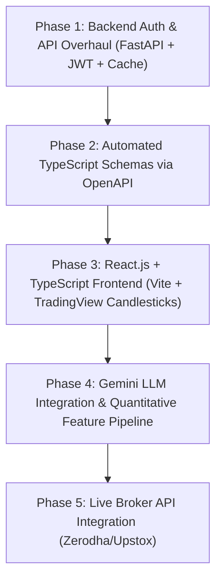
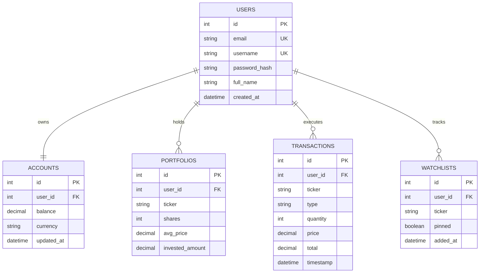
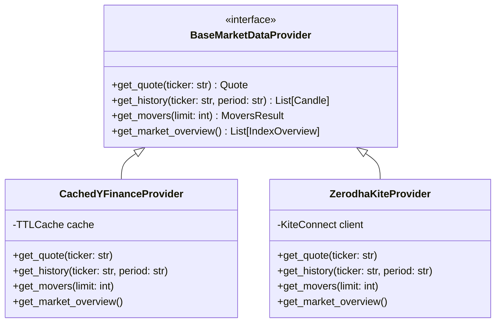

# TradePilot AI — Modernization Blueprint & Roadmap

This document outlines the strategic architectural overhaul for TradePilot AI. It captures all verified architectural decisions, detailing the transition to a **React.js + TypeScript** frontend, a high-performance **FastAPI** backend, **Multi-User JWT Authentication**, an abstracted **Market Data Layer** (yfinance now, broker API ready), and a **Google Gemini AI Assistant**.

---

## 1. Confirmed Architectural Decisions

The following architectural choices have been locked in:

| Decision Area | Chosen Path | Details & Implementation |
|---|---|---|
| **Frontend Framework & Language** | **React.js + TypeScript (Vite)** | Full type safety for financial numbers, OHLCV models, holdings, and order payloads. Vite for sub-second HMR. |
| **Market Data Provider** | **yfinance (with Caching & Batching)** | Free and instant for paper trading. Encapsulated inside a `BaseMarketDataProvider` interface for easy migration to a live broker API (Zerodha Kite, Upstox) later. |
| **Authentication Architecture** | **Multi-User Authentication (JWT + Bcrypt)** | Replaces hardcoded `WHERE id=1`. Complete user isolation for virtual balances, holdings, watchlists, and transaction histories. |
| **AI Assistant** | **Google Gemini API + Quantitative TA** | Generative natural-language market commentary and plain-English trade reasoning synthesized on top of quantitative technical indicators. |
| **Migration Sequence** | **Backend-First (API Contracts & Auth)** | Fast, typed, authenticated API endpoints established first, allowing React frontend to build against clean OpenAPI schemas. |

---

## 2. Which Modernization Comes First: Backend or Frontend?

### **Recommendation: Backend-First (API Contract & Auth Stabilization)**



### Why Backend First?
1. **Multi-User Data Isolation Dictates Frontend Architecture**: Building the React frontend first would require building temporary "guest/mock" state. Modernizing the backend first establishes real JWT authentication, user registration, and login flows from day one.
2. **API Contract Stabilization**: Legacy Flask endpoints return raw nested tuples like `[type, ticker, qty, total, timestamp]`. FastAPI with Pydantic ensures every response is a strictly typed JSON object (`{ "ticker": "TCS", "shares": 10, "avgPrice": 3450.00 }`).
3. **Automated TypeScript Typing**: FastAPI exports standard OpenAPI specifications (`/openapi.json`). Tools like `openapi-typescript` auto-generate TypeScript interfaces directly from backend models.
4. **Eliminates High-Latency Blockers**: Caching and batch downloading drop endpoint response times from 15 seconds to under 50ms, ensuring a fast UI development cycle.

---

## 3. Target Modern Tech Stack

| Domain | Current Stack | Modernized Stack | Key Justification |
|---|---|---|---|
| **Frontend Framework** | Vanilla JS (1.1k lines monolith) | **React.js 18+ (with Vite)** | Component reusability, declarative reactive UI, rich financial dashboard component ecosystem. |
| **Language** | Vanilla JavaScript | **TypeScript** | Eliminates runtime `TypeError` issues on financial data objects (OHLCV, holdings, prices). |
| **Charting** | Chart.js 4.4 (Line chart) | **TradingView Lightweight Charts** (`lightweight-charts`) | Purpose-built for financial trading. Zero-dependency, 45KB bundle, native support for Candlestick, Volume histogram, and crosshairs. |
| **State & Fetching** | Procedural `fetch` calls | **TanStack Query (React Query) + Zustand** | Automatic background caching, interval polling for stock ticks, window focus refetching, and optimistic UI updates. |
| **Styling & UI** | Custom CSS (1.4k lines) | **Tailwind CSS + Lucide Icons + shadcn/ui** | Rapid modern component assembly with dark-mode first design, matching Zerodha/TradingView aesthetics. |
| **Backend API** | Flask 3.1 (Dev server) | **FastAPI (ASGI / Uvicorn)** | Native async/await for concurrent external calls, high throughput, automatic request validation via Pydantic. |
| **Authentication** | None (hardcoded `WHERE id=1`) | **JWT Tokens + Passlib/Bcrypt** | Secure multi-user login/signup with stateless Bearer tokens and bcrypt password hashing. |
| **Data Validation** | Manual dictionaries / `request.json` | **Pydantic v2 Models** | Strictly validates every trade order (`quantity > 0`, ticker normalization, schema errors return 422). |
| **Database & ORM** | Raw SQLite queries | **SQLAlchemy 2.0 (Async) + Alembic** | Multi-user data models, database connection pooling, ACID transaction isolation, migration management. |
| **Market Data** | Synchronous `yfinance` scraper | **Abstracted Provider (yfinance + Cache)** | Batched, multi-threaded fetching with 60s TTL cache. Designed for drop-in live broker replacement. |
| **AI Engine** | Hardcoded SMA crossover rule | **Google Gemini API + Scikit-Learn** | Generative plain-English trade briefs and sentiment commentary driven by technical indicator features. |

---

## 4. Multi-User Authentication Architecture

### Database Schema (Relational Models)



### Authentication Endpoints
* `POST /api/auth/register`: Creates new user account, hashes password with `bcrypt`, seeds starter virtual ₹10,00,000 balance in `accounts`.
* `POST /api/auth/login`: Validates credentials, issues JWT `access_token` (and `refresh_token`).
* `GET /api/auth/me`: Returns profile of authenticated user.
* `POST /api/auth/logout`: Revokes session.

### Route Protection via FastAPI Dependency
```python
async def get_current_user(token: str = Depends(oauth2_scheme), db: AsyncSession = Depends(get_db)) -> User:
    # Verifies JWT signature and extracts user_id
    # Automatically injected into /api/buy, /api/sell, /api/portfolio
```

---

## 5. Market Data Architecture & Future Broker API Migration

To ensure we can transition seamlessly from **yfinance** to a **live broker API (Zerodha Kite / Upstox)** later without rewriting application routes or frontend components, market data is encapsulated behind a formal interface:



1. **Current Provider (`CachedYFinanceProvider`)**:
   - Uses multi-threaded `yf.download` for 15+ symbols in a single request.
   - In-memory TTL cache (15s for quotes, 60s for movers and indices).
2. **Future Broker Provider (`ZerodhaKiteProvider` / `UpstoxProvider`)**:
   - Uses real-time WebSocket ticks for sub-second quote streaming.
   - Drop-in replacement via environment variable: `MARKET_DATA_PROVIDER=zerodha`.

---

## 6. AI Trading Assistant (Google Gemini Integration)

### Pipeline Architecture
1. **Quantitative Feature Extraction**: Python backend computes mathematical indicators for requested ticker:
   - Moving Averages (MA5, MA20, EMA50, EMA200)
   - RSI (14-day)
   - MACD (MACD line, Signal line, Histogram)
   - 20-day Volatility and ATR
   - Day Change %, Volume Ratio vs 20-day average
2. **Prompt Synthesis & LLM Call**:
   - Prompt delivers quantitative facts + user's current holding status to Gemini.
   - Example prompt:
     ```
     Context: Stock TCS, LTP: ₹3,420, RSI: 68.2 (Overbought territory), MA5 > MA20 (+2.4% gap), Volume 1.8x avg. User holds 15 shares at ₹3,200 avg.
     Task: Provide a concise, 2-sentence institutional-grade trader insight and recommendation.
     ```
3. **Structured Response**:
   Returns plain-English synthesis displayed in the React AI Assistant panel and Floating Assistant Bot.

---

## 7. Modern React + TypeScript Architecture

```
frontend/
├── src/
│   ├── assets/              # Logos, theme icons
│   ├── components/
│   │   ├── auth/            # LoginForm, RegisterForm, AuthGuard
│   │   ├── layout/          # Sidebar, Topbar, UserMenu, Navigation
│   │   ├── market/          # IndexCards, MarketSentimentGauge, MoversGrid
│   │   ├── chart/           # TradingViewCandleChart, IndicatorToggles
│   │   ├── trading/         # OrderForm (Buy/Sell/Market), OrderConfirmation
│   │   ├── portfolio/       # HoldingsTable, PnLSummaryCard, StatsGrid
│   │   ├── history/         # TransactionHistoryTable, FilterChips
│   │   └── assistant/       # FloatingAiBot, GeminiInsightsFeed
│   ├── hooks/               # useAuth, useQuote, usePortfolio, usePrediction
│   ├── services/            # Axios API client with auto JWT Bearer interceptor
│   ├── store/               # Zustand stores (authStore, tradingStore, uiStore)
│   ├── types/               # TypeScript interfaces (User, Quote, Order, Holding, Candle)
│   ├── App.tsx
│   └── main.tsx
├── package.json
├── tailwind.config.js
├── tsconfig.json
└── vite.config.ts
```

### TypeScript Data Models (`types/index.ts`)
```typescript
export interface User {
    id: number;
    email: string;
    username: string;
    fullName: string;
}

export interface Candle {
    time: string; // YYYY-MM-DD or unix timestamp
    open: number;
    high: number;
    low: number;
    close: number;
    volume?: number;
}

export interface Holding {
    ticker: string;
    shares: number;
    avgPrice: number;
    currentPrice: number;
    invested: number;
    currentValue: number;
    pnl: number;
    pnlPct: number;
}

export interface TradeOrderRequest {
    ticker: string;
    quantity: number;
    type: "BUY" | "SELL";
}
```

---

## 8. Detailed Step-by-Step Implementation Plan

### Step 1: Backend Fast Foundation & Auth API (Python)
- Install and configure **FastAPI**, **Uvicorn**, **SQLAlchemy 2.0**, **Alembic**, and **PyJWT / Passlib**.
- Implement multi-user schema (`users`, `accounts`, `portfolios`, `transactions`, `watchlist`).
- Implement Auth endpoints (`/api/auth/register`, `/api/auth/login`, `/api/auth/me`).
- Implement the `BaseMarketDataProvider` and `CachedYFinanceProvider` with parallel batch downloads and TTL cache.
- Protect trading and portfolio endpoints with the `get_current_user` dependency.

### Step 2: React.js + TypeScript Frontend Scaffolding
- Initialize modern **Vite + React + TypeScript** in `frontend/`.
- Configure **Tailwind CSS** with dark trading theme (zinc/slate background, emerald `#00d97e` bullish, red `#ff4d5e` bearish).
- Set up **TanStack Query** for background polling and **Zustand** for auth/token management.
- Implement Axios client with automatic `Authorization: Bearer <token>` interceptor.

### Step 3: TradingView Candlestick Chart Integration
- Embed `lightweight-charts` component.
- Connect historical OHLCV data from `/api/history/{ticker}`.
- Add MA5/MA20 moving average overlay lines and volume histogram.

### Step 4: Multi-User Trading & Portfolio Views
- Build authenticated Dashboard: Portfolio summary cards, P&L badge, Holdings table.
- Build Order Pad: Buy/Sell with live price calculations and optimistic balance preview.
- Build Watchlist with real-time pin/unpin synced to authenticated user.

### Step 5: Gemini AI Trading Assistant Integration
- Integrate Google Gemini API client on backend.
- Connect AI intelligence feed and interactive Floating Chat Bot.
- Add backtesting and model training track.
